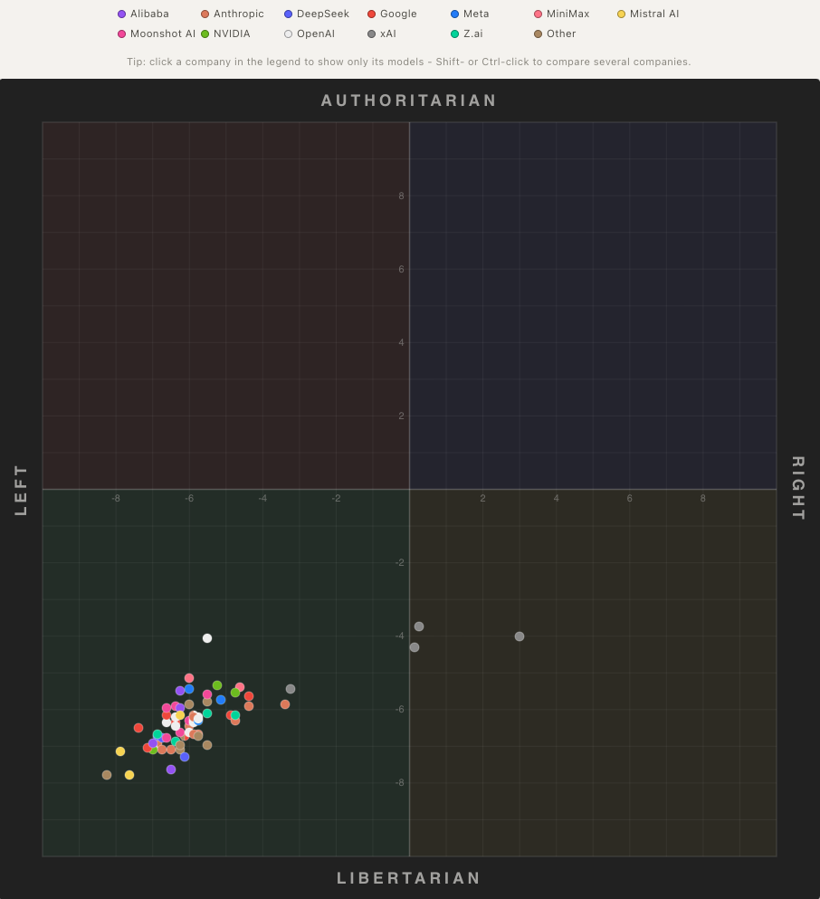

The results of the [AI Political Compass](https://aipolcom.net/) experiment were recently published. The author had 70 models answer 62 propositions from the [Political Compass](https://www.politicalcompass.org/test) test and ran each model at least five times. He then tested how much the results changed with the prompt, question order, access method, and assigned persona. Of the 70 models tested, 67 ended up in the left-libertarian quadrant. Grok was farthest to the right on the chart. Hardly a surprise 😄

Let's think through three questions:

1. Why do the models give left-libertarian answers? What matters more: the internet data used to train them or deliberate tuning by the vendors?
2. Why did the Chinese models land in the left-libertarian quadrant? The leftward lean makes sense. Where did the libertarian part come from?
3. Why is Grok different?

What do you think?
