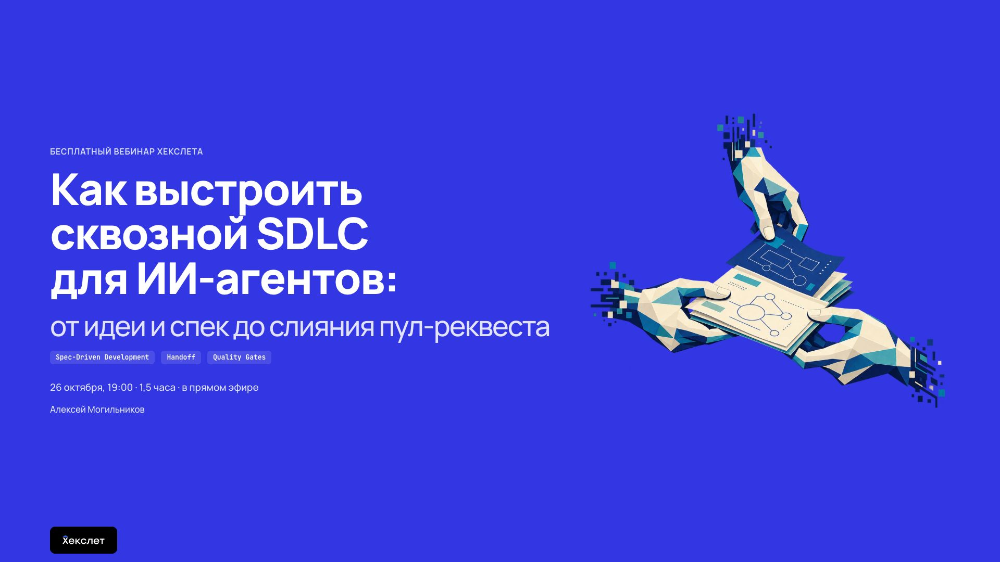

On Monday, I spoke at a Hexlet seminar. I explained what development with AI agents looks like when they are given almost the entire process rather than isolated tasks: from working with specs to a completed change.

If you're interested in autonomous and semi-autonomous development in practice, here's the recording. It's in Russian:
https://www.youtube.com/live/2740ayHpClY?si=a2LkYTPAzxcq8LWu&t=1095

Slides:
https://mogilnikov.name/agentic-sdlc-webinar
