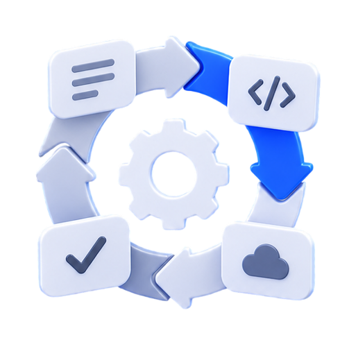

I haven't written in a while. Over the past few weeks, almost all of my free time has gone into one big project: I've been working with Hexlet on a course called "AI SDLC: Rebuilding Software Development for AI."

In the course, we look at how a modern agentic pipeline works and the levels of autonomy it can support. The context package for a product increment travels with the task throughout the process and grows at each stage. Agents specialize in different stages: requirements, specs, coding, review, and testing.

The main outcome of the course is a plan for moving your team toward a target process. Participants will assess their current process and design a pilot around their own project. The plan will include a baseline and criteria for deciding whether to scale the pilot or stop it.

The course is for CTOs, team leads, senior developers, and platform teams that already use agents and want to move to the next level of autonomy.

In Russian: https://ru.hexlet.io/programs/ai-sdlc
